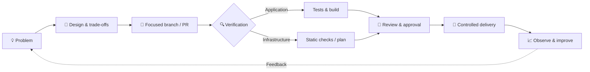

<!-- ────────────────────── PROFILE INTRO / ORIGINAL BRANDING ────────────────────── -->
<div align="center">
  
  <br/>
  <a href="https://trminhkhoi76-code.github.io/trminhkhoi76-code/">
    
  </a>
  <br/>
  
  
  
  
  <br/><br/>
  <a href="https://trminhkhoi76-code.github.io/trminhkhoi76-code/"><strong>🌐 Explore my portfolio ↗</strong></a>
  &nbsp; · &nbsp;
  <a href="https://github.com/trminhkhoi76-code?tab=repositories"><strong>💻 Browse my repositories ↗</strong></a>
</div>

---

### 👋 Hello, I'm Khoi

A **Backend & Software Engineer** based in Vietnam, with **around five years of experience** building APIs, working with data, integrating services, and gradually taking on more of the systems behind the product.

My favorite problems are usually invisible to the end user: authentication boundaries, infrastructure changes, deployment safety, reliability, and the mysterious bug that only appears after someone says *"but it works on my machine."*

A quick introduction, the Java way:

```java
import java.util.List;

public record EngineerProfile(String name, String focus, List<String> interests) {

    public static EngineerProfile meetKhoi() {
        return new EngineerProfile(
            "Minh Khoi Tran",
            "Backend · Cloud · Software Engineering",
            List.of("APIs", "System design", "AWS", "Automation", "Learning by building")
        );
    }

    public String philosophy() {
        return "Build thoughtfully. Verify honestly. Keep learning.";
    }

    public String funFact() {
        return "A green CI check is a beginning, not the whole story ☕";
    }
}
```

> **I build the things behind the “it just works.”** The goal is software that's useful, understandable, and easier to operate tomorrow than it was yesterday.

---

### 🚪 Pick your path

*Not everyone visiting a profile is looking for the same thing. Choose your adventure.*

<details>
<summary><b>💼 I'm a client or recruiter — what can you help me build?</b></summary>

<br/>

I work best on engineering problems that need a mix of **backend depth, practical delivery, and clear communication**.

| How I can help | The kind of work |
|---|---|
| ⚙️ **Backend & APIs** | API design, Spring Boot services, authentication flows, integrations, data handling |
| ☁️ **Cloud & infrastructure** | AWS environments, Terraform, deployment workflows, IAM boundaries |
| 🚀 **Delivery & reliability** | CI/CD, debugging, operational logs, reviewable changes, safer releases |
| 🌍 **Product engineering** | Web apps, service integration, Node.js / TypeScript / Next.js solutions |
| 🔎 **Technical review** | Architecture trade-offs, code review, maintainability and verification plans |

**Let's talk about your problem, not just your tech stack.**  
[Explore my portfolio](https://trminhkhoi76-code.github.io/trminhkhoi76-code/) · [View my public work](https://github.com/trminhkhoi76-code?tab=repositories)

</details>

<details>
<summary><b>🛠️ I'm an engineer — show me how you think and ship</b></summary>

<br/>

I care about **clear boundaries, evidence before conclusions, and knowing what happens after a PR is merged**.

This is my preferred *engineering approach*, not a claim that every public repository implements every stage:



**Three habits I bring to a codebase:**

- 🧾 **Evidence over assumptions** — distinguish a passing test, a simulation and a real environment result.
- 🔐 **Security as a boundary** — consider authentication, IAM scope and impact before release.
- 🧹 **Small changes, clear explanations** — help the next developer understand *why*, not only *what*.

Want implementation details? Start with [Auth Service](https://github.com/trminhkhoi76-code/auth-service) or the [IAM verification lab](https://github.com/trminhkhoi76-code/verify-iam-policies).

</details>

<details>
<summary><b>🎲 I'm just curious — show me something interesting!</b></summary>

<br/>

Here are three places to wander:

- 🗺️ **[Meridian Travel](https://github.com/trminhkhoi76-code/meridian-travel-atlas)** — destination discovery, an itinerary planner, interactive maps, and an admin experience. Some booking/business workflows remain **mock**.
- 🔐 **[Auth Service](https://github.com/trminhkhoi76-code/auth-service)** — a Spring Boot authentication project with JWT, database migrations, and integration tests.
- 🧪 **[IAM Verification Lab](https://github.com/trminhkhoi76-code/verify-iam-policies)** — Terraform configurations for exploring AWS permission coverage. A verification environment, **not** a production app.

Or browse the [interactive portfolio](https://trminhkhoi76-code.github.io/trminhkhoi76-code/) to see how my engineering interests have grown.

**A little philosophy:** The best kind of technical magic is when nothing mysterious is left for the person on call. ✨

</details>

---

### 🧰 My toolbox

*Tools change. The habit of understanding how they fit together doesn't.*

<table>
  <tr>
    <th align="center" width="25%">Backend &amp; data</th>
    <th align="center" width="25%">Cloud &amp; infrastructure</th>
    <th align="center" width="25%">Delivery &amp; workflow</th>
    <th align="center" width="25%">Web &amp; automation</th>
  </tr>
  <tr>
    <td align="center"></td>
    <td align="center"></td>
    <td align="center"></td>
    <td align="center"></td>
  </tr>
  <tr>
    <td align="center"><sub>Spring Boot · REST · JWT · Flyway</sub></td>
    <td align="center"><sub>IAM · ECS · ECR · CloudWatch</sub></td>
    <td align="center"><sub>CI/CD · PR review · Verification</sub></td>
    <td align="center"><sub>APIs · Integration · Playwright</sub></td>
  </tr>
</table>

---

### 🌱 How my engineering mindset has grown

| Perspective | What I'm learning to own |
|---|---|
| **01 / Foundations** | Build APIs, handle data and errors, keep code readable and testable. |
| **02 / Systems thinking** | Look beyond one service: identity, integrations, failure modes and architecture trade-offs. |
| **03 / Cloud & delivery** | Think about Terraform, permissions, CI/CD, observability and what happens after deploy. |
| **04 / Product mindset** | Connect technical decisions with real user needs and help teams deliver with confidence. |

*This describes a progression in responsibilities and interests — not invented job dates or titles.*

---

### 🧪 Selected public projects

<table>
  <tr>
    <td width="50%" valign="top">
      <h3>🗺️ <a href="https://github.com/trminhkhoi76-code/meridian-travel-atlas">Meridian Travel</a></h3>
      A Next.js travel storefront with destination browsing, trip planning and admin UX.<br/><br/>
      
      
      <br/><sub>Real app code; booking persistence, mail and parts of the catalog are not production-backed yet.</sub>
    </td>
    <td width="50%" valign="top">
      <h3>🔐 <a href="https://github.com/trminhkhoi76-code/auth-service">Auth Service</a></h3>
      Java 21 / Spring Boot auth API with JWT, MySQL, Flyway and Testcontainers integration tests.<br/><br/>
      
      
      <br/><sub>Includes AWS development delivery config; the live AWS role setup still needs validation.</sub>
    </td>
  </tr>
  <tr>
    <td width="50%" valign="top">
      <h3>☁️ <a href="https://github.com/trminhkhoi76-code/verify-iam-policies">Verify IAM Policies</a></h3>
      Terraform-based verification workbench for AWS permissions, resource coverage and reviewable evidence.<br/><br/>
      
      
      <br/><sub>Some configurations can operate on real AWS resources; this is not a production deployment.</sub>
    </td>
    <td width="50%" valign="top">
      <h3>✳ <a href="https://trminhkhoi76-code.github.io/trminhkhoi76-code/">My interactive portfolio</a></h3>
      A bilingual, responsive introduction to the way I think, build and grow as an engineer.<br/><br/>
      
      
      <br/><sub>Static site, English/Vietnamese, no application backend or analytics tracker.</sub>
    </td>
  </tr>
</table>

---

### 📈 GitHub activity

<p align="center">
  <picture>
    <source media="(prefers-color-scheme: dark)" srcset="https://streak-stats.demolab.com?user=trminhkhoi76-code&theme=dark&hide_border=true&background=0D1117&ring=79dbc8&fire=79dbc8&currStreakLabel=79dbc8" />
    
  </picture>
</p>

<details>
<summary><b>📊 Show my public contribution graph</b></summary>

<br/>
<p align="center">
  <picture>
    <source media="(prefers-color-scheme: dark)" srcset="https://github-readme-activity-graph.vercel.app/graph?username=trminhkhoi76-code&bg_color=0D1117&color=C3D7D8&title_color=79dbc8&line=79dbc8&point=ffffff&area=true&hide_border=true" />
    
  </picture>
</p>

</details>

<sub>Charts are provided by external public-GitHub visualization services; they reflect publicly available activity, not the full scope of private professional work.</sub>

---

### 🤝 Let's build something useful

I'm interested in **backend development, service integrations, cloud automation, software modernization and code reviews** — especially when the goal is practical, maintainable software.

**Want to collaborate?** Start with my [portfolio](https://trminhkhoi76-code.github.io/trminhkhoi76-code/) or reach out through [GitHub](https://github.com/trminhkhoi76-code).

<details>
<summary><b>🇻🇳 Xin chào — một chút tiếng Việt</b></summary>

<br/>

Mình là Khôi, một Backend / Software Engineer với khoảng 5 năm kinh nghiệm. Mình thích những bài toán kỹ thuật phía sau sản phẩm: API, xác thực, hệ thống phân tán, AWS, Terraform, CI/CD và tự động hóa.

Mục tiêu của mình là viết phần mềm **đủ rõ ràng để bảo trì, đủ an toàn để vận hành, và đủ thực tế để tạo ra giá trị**. Mình sẵn sàng trao đổi về các dự án freelance, hợp tác phát triển web/app, backend và review code.

Cảm ơn bạn đã ghé thăm! ☕ 

</details>

<p align="center">
  
</p>
