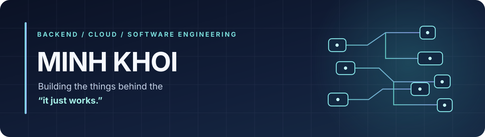

<div align="center">



<br/>

### Hey, I'm Minh Khoi 👋

**Backend & Software Engineer** · **~5 years of experience** · **Based in Vietnam**

*I turn complex requirements into practical software — and I like knowing exactly why it works.*

[](https://github.com/trminhkhoi76-code?tab=repositories)
[](https://github.com/trminhkhoi76-code)

</div>

---

### 👨‍💻 A little about me

I'm a software engineer who spends a lot of time working on the *invisible* parts of products: APIs, authentication, infrastructure, automation, and the details that keep a system dependable.

I enjoy taking an idea from **“could this work?”** to **“here's how we can build, test, operate, and improve it.”** I care about clean boundaries, sensible trade-offs, readable code, and security that is part of the design — not an afterthought.

> **My favorite kind of complexity is the kind users never have to notice.**

### 🛠️ Things I build with

**Backend & application development**


**Cloud, delivery & infrastructure**


*Tools are useful. Understanding the trade-offs is the real skill.*

### 🚀 Selected projects

| Project | What I'm exploring / building | Status |
| :--- | :--- | :--- |
| **[Meridian Travel](https://github.com/trminhkhoi76-code/meridian-travel-atlas)** | A Next.js travel storefront with destination discovery, itinerary planning, auth integration and an admin interface. | **Live application code · booking and some business data are demo/mock** |
| **[Auth Service](https://github.com/trminhkhoi76-code/auth-service)** | A Java 21 / Spring Boot service with JWT authentication, MySQL, Flyway migrations, integration tests and AWS deployment infrastructure. | **Application + automated tests · dev deployment path** |
| **[Verify IAM Policies](https://github.com/trminhkhoi76-code/verify-iam-policies)** | A Terraform-based environment for investigating AWS deployment permissions and verifying infrastructure policy coverage. | **Verification lab · not a production deployment** |

I prefer showing **what is implemented, what is tested, and what is still a prototype** rather than putting a shiny “production-ready” label on everything.

### 🧠 My engineering mindset

```text
Understand the problem
      ↓
Design for change, not just the happy path
      ↓
Build something useful
      ↓
Test the behavior + verify the real environment
      ↓
Document the trade-offs and ship with confidence
```

A few things I keep coming back to: **API design · authentication & security · AWS infrastructure · CI/CD · troubleshooting · developer experience · automation**.

### 🤝 Let's build something useful

I'm interested in **freelance projects, engineering collaborations, and interesting technical problems**, especially around:

- Backend APIs, service integration, and web applications
- Cloud infrastructure, deployment workflows, and automation
- Code reviews, refactoring, maintainability, and security-minded improvements

Have a product idea, an API to untangle, or a workflow that deserves less manual work? **I'd love to hear about it.**

**→ [Explore my repositories](https://github.com/trminhkhoi76-code?tab=repositories)**

---

<details>
<summary><strong>🇻🇳 Một chút tiếng Việt</strong></summary>

Xin chào! Mình là Khôi, một Backend / Software Engineer với khoảng 5 năm kinh nghiệm.

Mình thích xây dựng API, hệ thống backend, tự động hóa và các giải pháp cloud có thể vận hành, bảo trì và mở rộng một cách rõ ràng. Mình cũng quan tâm đến những sản phẩm thực tế có trải nghiệm người dùng tốt.

Nếu bạn đang tìm người hợp tác phát triển website, ứng dụng, backend, tích hợp hệ thống hoặc review code, rất vui được kết nối và trao đổi!

</details>

<div align="center">

<sub>Build thoughtfully. Verify honestly. Keep learning. ☕</sub>

</div>
